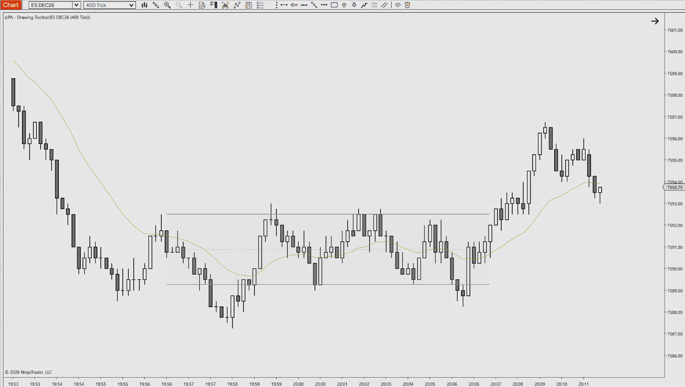

# Range Band for NinjaTrader 8

A specialized Drawing Tool engineered for Price Action day trading. Range Band marks a trading range between resistance and support, adds a 50% equilibrium line with optional 25% / 75% quarter lines, and shows the range size in points and ticks.

---

## 📺 Video Walkthrough & Setup

Watch the complete breakdown of parameters, price action context, and chart examples on YouTube:

> **[▶ Click here to watch the full YouTube walkthrough](https://youtube.com/@icPriceAction)**

---

## ⚡ Key Features

- **Range in two clicks:** Click the first corner, then the second, to draw a shaded band with resistance on top and support below. Prices snap to the instrument's tick size.
- **Equilibrium and quarter levels:** A dashed 50% midline is shown by default, with optional dotted 25% / 75% lines. A badge reads the range size (e.g. `Range: 6.50 pts (26 ticks)`) and moves below the band when it would be cut off at the top of the panel.
- **Edit without fighting it:** Eight handles (four corners, four edge midpoints) resize the band without jumping to the cursor. Drag a line, or anywhere inside a selected band, to move it, including into the right margin. Optional Extend Right projects the levels to the edge of the chart. Locked bands cannot be moved or edited.
- **PATS & Context Aligned:** Designed for Price Action principles (Mack / Thomas Wade) and disciplined futures execution.
- **Zero Chart Lag:** Native C# execution optimized to prevent UI freezes on high-frequency 2000-tick ES/MES charts.
- **Clean Visuals:** Complementary default palette that preserves candlestick clarity without chart clutter.
- **Fully Customizable:** Configure colors, line width, fill opacity, levels and the stats badge via the native NT8 settings panel.

---

## ⚠️ Prerequisites & Data Requirements

- Works on any chart, instrument and bar type. No Tick Replay, specific Calculate mode or market depth data is required.
- Ranges smaller than 2 ticks are automatically expanded to 8 ticks so the band stays usable.

---

## 📥 Installation Guide

1. Head to the **[Releases](https://github.com/icPriceAction/range-band/releases)** tab of this repository.
2. Download the latest release `.zip` file (`icPriceAction_RangeBand_v1.3.1.zip`).
   - *Note: Do NOT extract or unzip the file.*
3. Open **NinjaTrader 8**.
4. In the Control Center, navigate to:
   `Tools` ➔ `Import` ➔ `NinjaScript Add-On...`
5. Select the downloaded `.zip` file and click **Open**.
6. A success dialog will appear confirming the tool has been imported.
7. Open any chart, open the Drawing Tools menu, and select **Range Band**.

---

## ⚙️ Parameters & Configuration

| Parameter | Group | Type | Default | Description |
| :--- | :--- | :--- | :--- | :--- |
| Show 50% Midline | 1. General | Boolean | True | Draws the dashed 50% equilibrium line between resistance and support. |
| Show 25% / 75% Lines | 1. General | Boolean | False | Draws dotted quarter lines at 25% and 75% of the range. |
| Show Range Stats Badge | 1. General | Boolean | True | Shows the range size in points and ticks above the band (below it when clipped at the top of the panel). |
| Extend Right | 1. General | Boolean | False | Extends the band lines and fill to the right edge of the chart panel. |
| Resistance Line Color | 2. Visuals | Brush | `#8E8E8E` | Color of the top (resistance) line. |
| Support Line Color | 2. Visuals | Brush | `#8E8E8E` | Color of the bottom (support) line. |
| 50% Midline Color | 2. Visuals | Brush | `#8E8E8E` | Color of the 50% midline. The 25% / 75% lines use this color at lower opacity. |
| Interior Fill Color | 2. Visuals | Brush | `#C6C6C6` | Color of the shaded area between resistance and support. |
| Fill Opacity (%) | 2. Visuals | Integer (0–100) | 10 | Opacity of the interior fill. 0 turns the fill off. |
| Line Width | 2. Visuals | Number (1–10) | 2 | Width of the resistance and support lines in pixels. |
| Stats Badge Font Size | 2. Visuals | Number (8–24) | 14 | Font size of the range stats badge. |

---

## 📝 Changelog

- **v1.3.1** (2026-11-03) - Initial public release. Cleaned and optimized by icPriceAction: cached Direct2D brushes and badge text layout (no per-frame allocations), lighter mouse handling, regrouped settings with descriptions.
- **v1.3.0** (date unknown) - Grey default palette and line width 2, custom toolbar icon, locked bands can't be edited, minimum width only on creation, tick-snapped prices, auto-sized and flipping badge, delta-based handle resizing, Extend Right and 25% / 75% lines, autoscale support.
- **v1.2.1** (date unknown) - Slot-based right-margin movement, minimum width protection.

---

## ☕ Support the Project

All tools provided by **icPriceAction** are 100% free and open-source for personal trading use. These tools, even though supported by AI have taken considerable time to design, build, test and package. If these tools bring you value, consider supporting continued development:

- **Prop Firm Traders:** Use discount code **`ICPAT`** at checkout across top futures prop evaluation firms ([View Active Discounts](https://icpriceaction.com/prop-firms.html)).
- **Profitable Traders:** Send a one-time tip to support my continued support and time, server hosting and open-source updates via [Buy Me a Coffee](https://buymeacoffee.com/icpriceaction).

---

## 🐛 Bug Reports & Feature Requests

Found an issue or have an enhancement idea?
Please submit an issue on the [Issues tab](https://github.com/icPriceAction/range-band/issues).

---

## License

Free for personal trading use. Commercial resale, redistribution, or repackaging is strictly prohibited. See [LICENSE](LICENSE).

---

## ⚖️ Disclaimer

Futures trading involves substantial risk of loss and is not suitable for every investor. All indicators, drawing tools, strategies, and documentation provided by **icPriceAction** are for educational and analytical purposes only. Nothing herein constitutes financial or investment advice. Automated strategies can lose money and may behave differently in live markets than in simulation or backtests.

NinjaTrader® is a registered trademark of NinjaTrader, LLC. icPriceAction is an independent developer with no official affiliation to NinjaTrader, LLC.